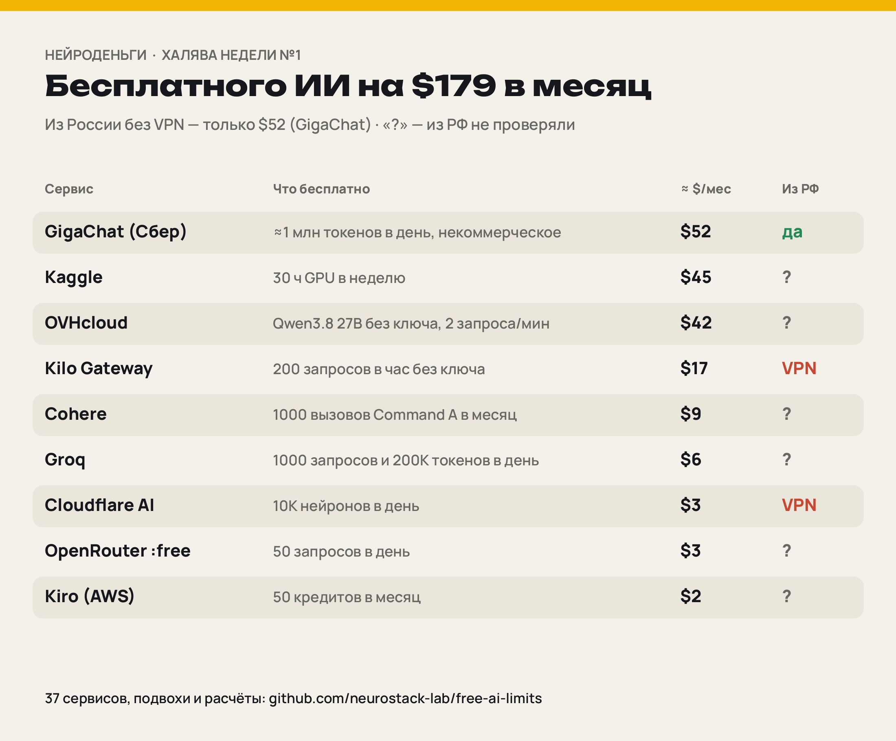

# Халява недели: бесплатные лимиты ИИ

Рубрика канала [НейроДеньги](https://t.me/neurodengi_news) — выпуск №1, 17.10.2026. Каждую неделю считаем, сколько ИИ можно взять бесплатно, сколько это стоило бы в деньгах и что из этого работает из России.



## Главное

- Бесплатного ИИ без карты — на **$179.3 в месяц (≈14 993 ₽)**, если выжимать лимиты каждый день и считать по ценам платных аналогов.
- Без GPU (Kaggle) — $134.3 (≈11 230 ₽).
- Из России без VPN подтверждён только **GigaChat — $52.32 (≈4 375 ₽)**. Z.ai, OpenCode Zen и Mistral тоже работают из РФ, но их лимит в деньгах не посчитать.
- Студентам и с зарубежной картой — ещё $59.99 (Google AI Pro для студентов, Copilot Student, Modal).

### Коротко по сервисам

- В таблицах ниже **36 сервисов** (плюс «кладбище» закрытой халявы).
- **GigaChat (Сбер)** — ≈1 млн токенов в день без карты, только для личного некоммерческого использования, ≈ $52/мес.
- **Kaggle** — 30 ч GPU в неделю, ≈ $45/мес.
- **OVHcloud** — Qwen3.8 27B без ключа и регистрации, 2 запроса в минуту, ≈ $42/мес.
- **Groq** — 1000 запросов в день, gpt-oss-120b на ~350 токенов в секунду (88 баллов в нашем замере), ≈ $6/мес.
- Наш живой замер: лимиты в заголовках ответа показывают только Groq и OVH.
- За 2026 год закрыли бесплатные Qwen Code (15.04), Gemini CLI на 1000 запросов в день (18.06) и GitHub Models (30.07).

## Без карты — входит в итог $179/мес

| Сервис | Что бесплатно | Лимит | ≈ $/мес | Из РФ | Подвох | Источники |
|---|---|---|---|---|---|---|
| **GigaChat API (Сбер), Freemium для физлиц** | 365 млн токенов на 12 мес.: 250 млн Lite, 40 млн Pro, 25 млн Max, 50 млн GigaChat-3-Ultra | ≈1 млн токенов в день в среднем (365 млн / 365 дней), 1 поток | $52.32 | работает (подтверждено источником) | Нельзя в коммерцию: «результаты Freemium предназначены для личного некоммерческого использования» (цитата официальной страницы по vc.ru: https://vc.ru/ai/3047363-gigachat-besplatno-milion-tokendov). 1 поток. С 01.09.2026 новые клиенты оплачивают модели через cloud.ru; дают ли им Freemium — на странице не сказано, проверить. В оценке $ не учтены 50 млн токенов Ultra (нет цены пакета). | [1](https://developers.sber.ru/docs/ru/gigachat/tariffs/individual-tariffs) |
| **Kaggle Notebooks — GPU и TPU** | ~30 ч GPU в неделю (P100 или 2×T4) + ~20 ч TPU v3-8 | 30 ч GPU в неделю, сессия до 12 ч | $45.00 | сайт открывается, российский номер для подтверждения может не пройти | Квота тикает по часам, даже если ноутбук простаивает. | [1](https://aifree.dev/offer/kaggle-free-gpu-tpu) |
| **OVHcloud AI Endpoints (без ключа)** | ~20 открытых моделей без регистрации: Qwen3.8 27B, Qwen3.5 397B, gpt-oss-120b, Mistral Small 3.2 | 2 запроса в минуту на IP и модель (подтверждено нашим замером: x-ratelimit-limit-minute=2) | $42.05 | не проверяли (замер из Германии) | 2 запроса в минуту — для бота «для себя» и демо, не для нагрузки. Условия могут поменять без предупреждения. | [1](https://docs.ovhcloud.com/en/guides/public-cloud/ai-machine-learning/ai-endpoints-capabilities) |
| **Kilo Gateway / Kilo Code (без ключа)** | модели :free и роутер kilo-auto/free: Nemotron 3 Ultra/Super, Qwen3.8 27B, Laguna, North Mini Code | 200 запросов в час на IP | $16.56 | из РФ шлюз виснет до таймаута (Хабр, 01.10.2026) | Часть бесплатных моделей требует разрешить сбор данных; автороутер может отдать запрос логирующему провайдеру. Состав меняется постоянно. | [1](https://kilo.ai/docs/gateway/usage-and-billing) |
| **Cohere (trial-ключ)** | все модели: Command A, A+, A Reasoning, A Vision, Embed, Rerank | 1000 вызовов в месяц (~33 в день), Chat 20 в минуту | $8.75 | санкционные регионы ограничены, не проверяли | Только некоммерческое использование, не для продакшена. | [1](https://docs.cohere.com/docs/rate-limits) [2](https://agentdeals.dev/free-llm-apis) |
| **Groq** | gpt-oss-120b, gpt-oss-20b, Qwen3.8 27B (Preview), Whisper, Orpheus TTS | 1000 запросов и 200K токенов в день на модель, 8K токенов в минуту | $6.17 | не проверяли, рассчитывать на VPN | Первым кончается лимит 8K токенов в минуту. Preview-модели не для продакшена. Модели убирают без анонса. Llama с 16.08.2026 только Enterprise. | [1](https://console.groq.com/docs/rate-limits) [2](https://agentdeals.dev/free-llm-apis) |
| **Cloudflare Workers AI** | 10 000 нейронов в день на ~60 моделей: gpt-oss-120b, Llama 3.3 70B, Qwen3.8 27B, Gemma 4 | 10K нейронов ≈ 147K выходных токенов gpt-oss-120b | $3.30 | Cloudflare в РФ замедляют и блокируют | Kimi K2.6/K2.7 Code и GLM-5.2 с 28.07.2026 только на платном плане, GLM-5.3 и ещё ряд моделей — тоже только Paid (на бесплатном 403). Данные на обучение не идут. | [1](https://developers.cloudflare.com/workers-ai/platform/pricing/) [2](https://agentdeals.dev/free-llm-apis) |
| **OpenRouter (:free)** | 16 моделей :free: Nemotron 3 Ultra 550B, Gemma 4 31B, Inkling, Laguna, North Mini Code и др. | 50 запросов в день, 20 в минуту | $3.15 | сайт обычно открывается, официально не подтверждено | Лимит 1000 в день открывается только после разовой покупки кредитов на $10 (российской картой нельзя). Бесплатные провайдеры могут логировать промпты, в часы пик — 429. | [1](https://openrouter.ai/api/v1/models) [2](https://openrouter.ai/docs/api-reference/limits) |
| **Kiro (AWS) Free** | 50 кредитов в месяц, бессрочный бесплатный тариф (по словам Kiro, условия могут поменять): открытые модели и Claude Sonnet 4.5 | 50 кредитов в месяц (~1,7 в день) | $2.00 | не проверяли | 50 кредитов уходят за несколько серьёзных задач. Бонус 500 кредитов отменён в мае–июне 2026. Студентам — год с 1000 кредитов в месяц. | [1](https://kiro.dev/pricing/) |

Итого: **$179.30 в месяц**.

## Студентам и с зарубежной картой (+$60/мес)

| Сервис | Что бесплатно | Лимит | ≈ $/мес | Из РФ | Подвох | Источники |
|---|---|---|---|---|---|---|
| **Modal Starter** | $30 в месяц на serverless GPU/CPU | $30 в месяц, не переносится | $30.00 | российские карты не принимают | С привязанной картой можно выйти за $30 и получить счёт — ставьте лимит расходов. | [1](https://aicreditmart.com/ai-credits-providers/modal-free-tier-how-to-get-30-month-in-compute-credits-2026/) |
| **Google AI Pro / AI Plus для студентов, 12 мес.** | в США — AI Pro (лимиты Gemini ×4, 5 ТБ), в 140+ странах — AI Plus (×2, 400 ГБ) | 12 мес. от активации, активировать до 31.12.2026 | $19.99 | РФ нет в списке стран; только для учащихся за рубежом | Нужна карта и SheerID. Автопродление с 366-го дня — отмените заранее. Гайды про «15 месяцев до 31.01.2026» — старая кампания. | [1](https://gemini.google/students/) |
| **GitHub Copilot Student (Student Developer Pack)** | безлимитные дополнения, ~200 AI-кредитов в месяц, GitHub Pro и 60+ офферов партнёров | пока подтверждён статус студента | $10.00 | студентам вузов РФ одобряли, но из-за санкций возможны отказы | Модель выбирается только автоматически с 24.06.2026, облачного агента нет. Регистрацию закрывали с 20.04 по ~17.06.2026. | [1](https://github.blog/changelog/2026-04-20-changes-to-github-copilot-plans-for-individuals/) |

## Не бесплатно, но рядом

| Сервис | Что бесплатно | Лимит | ≈ $/мес | Из РФ | Подвох | Источники |
|---|---|---|---|---|---|---|
| **OpenRouter :free после разовой оплаты $10** | те же :free модели, но 1000 запросов в день | 1000 запросов в день | $63.00 | оплатить российской картой нельзя (зарубежная карта или крипта) | Это не бесплатно: нужно один раз заплатить $10. В итоги не включаем. | [1](https://openrouter.ai/docs/api-reference/limits) |

## Бесплатно, но в деньгах не посчитать

Лимиты не опубликованы, или это разовые кредиты и гранты — в итог не входят.

| Сервис | Что бесплатно | Лимит | Из РФ | Подвох | Источники |
|---|---|---|---|---|---|
| **Google AI Studio (Gemini API)** | Gemini 3.8/3.6 Flash, 3.5 Flash-Lite, Gemma 4, эмбеддинги, Live/TTS | Google цифры не публикует (видны в кабинете); сторонние оценки 15–30 RPM, до 1500 RPD | РФ не в списке регионов, нужен VPN | Данные бесплатного уровня идут на обучение, вне ЕЭЗ их могут читать люди. Поиск для 3.x на бесплатном уровне недоступен. Новые $300 кредита Cloud на Gemini API тратить нельзя. | [1](https://ai.google.dev/gemini-api/docs/pricing) |
| **NVIDIA build (NIM Free Endpoints)** | 60–80 моделей: DeepSeek V4.1 Flash, GLM 5.3 Flash, Gemma 4 31B, Nemotron 3, Step 5 Preview | до 40 RPM; ~10K запросов в день на модель — сторонняя оценка | NVIDIA ушла из РФ, не проверяли | Только тестирование, не продакшен. NVIDIA записывает промпты и ответы. Модели снимают быстро: Kimi K3 ушёл 15.10, GLM 5.3 — до 27.10.2026. | [1](https://agentdeals.dev/free-llm-apis) |
| **Z.ai — GLM-4.7-Flash / 4.6V-Flash** | вход и выход полностью бесплатны | 1 одновременный запрос; дневной лимит не указан | работает без VPN по нашему опыту, официально не заявлено | Бесплатны только старые 4.x; GLM-5.3 Flash платный ($0.15/$0.50). Сервер в Китае. В freebench GLM-4.7 Flash — 67 баллов, последнее (28-е) место. | [1](https://docs.z.ai/guides/overview/pricing) |
| **Mistral AI Free (API + Le Chat/Vibe)** | месячная квота на API, Studio и Vibe: Small 4, Codestral, Ministral, labs-модели | сумму квоты ($10/мес) убрали со страницы 07.10.2026; ~1 RPS | кабинет и API доступны без VPN (Хабр, 01.10.2026) | С 08.2026 API формально только для бизнеса. Обучаются на ваших данных, если не отключить (labs/preview — даже после отключения). | [1](https://agentdeals.dev/free-llm-apis) |
| **Ollama Cloud Free** | стартовые кредиты на малую группу облачных моделей; локальный запуск без ограничений | 1 поток, квота раз в месяц, размер не указан | сайт открывается, не проверяли | Сильные модели (DeepSeek V4, Kimi K3, Beam 501B) — только после покупки кредитов. Плюс: промпты не логируют. Наш замер Beam шёл по платному Pro — это не халява. | [1](https://ollama.com/pricing) |
| **Alibaba Cloud Model Studio (новым пользователям)** | ~1 млн токенов на каждую модель Qwen (qwen3.8-max, 3.7-max, 3.6-plus и др.) | разово, ~1 млн токенов на модель на 90 дней | регистрация с данными РФ под вопросом | После конца квоты включается оплата по факту — сами включите «Free Quota Only». Только регион Singapore. | [1](https://www.alibabacloud.com/help/en/model-studio/new-free-quota) |
| **Hetzner Inference API (эксперимент)** | Qwen3.8-27B и Qwen3.6-35B-A3B, контекст 262K | 10 запросов в минуту на ключ (по AgentDeals, официально не подтверждено) | Hetzner обычно не принимает клиентов из РФ | Бесплатно, пока эксперимент; об окончании обещают письмо. Запросы, по словам Hetzner, не хранятся. | [1](https://agentdeals.dev/free-llm-apis) |
| **LLM7.io** | turbo без ключа; с бесплатным токеном gpt-oss:20b, DeepSeek-V4-Flash, MiniMax M2.7 | 100K токенов в день, 250 запросов в час (с токеном) | не проверяли | Маленький сервис из UK, квоту могут урезать без предупреждения. Что делают с промптами — неизвестно. | [1](https://github.com/mnfst/awesome-free-llm-apis) |
| **Nous Portal (тариф $0)** | только бесплатные модели (Step 3.7 Flash и др.); Beam 501B и Solar Mini 4 значатся бесплатными на free-llms.ru | «стандартные лимиты»; сторонние данные ~50 RPM | не проверяли | Состав бесплатных моделей меняется каждый месяц, часть — недельные акции. | [1](https://portal.nousresearch.com/) |
| **Google Antigravity (IDE + CLI agy), тариф Individual** | Tab и Command без лимита + недельная квота агента; Gemini 3.x, Claude Sonnet/Opus 4.6 до 02.11.2026 | «meaningful quota, refreshed weekly» — цифр нет | сервисы Google на ИИ отвечают 403 unsupported_country (Хабр, 01.10.2026) | Квота меряет объём работы, а не промпты. Claude из бесплатного тарифа уходит 02.11.2026. Свой ключ подключить нельзя. | [1](https://antigravity.google/pricing) |
| **Google Jules (агент на GitHub-репо)** | агент клонирует репо, делает задачу, открывает PR | 15 задач за 24 ч, 3 одновременно | Google ИИ из РФ — 403; Jules отдельно не проверяли | Цифры из сторонних обзоров (hackup.ai, 07.2026), модель бесплатного тарифа неясна. | [1](https://hackup.ai/ai-plans/jules/) |
| **GitHub Copilot Free** | 2000 автодополнений и 50 чат-запросов в месяц + немного AI Credits | 2000 дополнений и 50 чатов в месяц | API Copilot блокируется на edge (Хабр, 01.10.2026) | Схема «premium requests по $0.04» отменена 01.06.2026 — старые гайды врут. Pro+ подорожал до $39. | [1](https://github.com/features/copilot/plans) |
| **OpenCode + бесплатные модели Zen** | open-source агент + бесплатные модели: Big Pickle, MiMo-V2.5, Ling 3.0 Flash, Nemotron 3 Ultra, контекст до 1M | не опубликован, часть моделей — временная акция | сайт, кабинет и API отвечают из РФ (Хабр, 01.10.2026); у отдельных моделей бывает RegionError | Модели слабее флагманов, список меняется раз в несколько недель, промпты часто идут на обучение. | [1](https://opencode.ai/docs/zen) |
| **JetBrains AI Free (AI Assistant + Junie)** | безлимитные дополнения на Mellum и с локальными моделями + 3 AI-кредита на 30 дней | 3 кредита в месяц (1 кредит = $1) | JetBrains не продаёт в РФ с 2022, облачный AI не проверяли | 3 кредита — это 1–3 задачи Junie в месяц. Ценность в основном в локальных дополнениях. | [1](https://www.jetbrains.com/ai-ides/buy/) |
| **Windsurf Free (Devin Desktop)** | лёгкая квота Cascade, Tab без лимита, можно свой ключ (BYOK) | дневные/недельные квоты без цифр (с 19.03.2026) | из РФ редирект на /restricted (Хабр, 01.10.2026) | «25 кредитов в месяц» — устарело. Акция SWE-2 бесплатно закончилась 16.10.2026. | [1](https://windsurf.com/pricing) |
| **OpenAI Codex на бесплатном ChatGPT** | Codex CLI, веб и IDE — только локальные задачи | окно 5 ч + недельный лимит, цифр нет | 403 unsupported_country | Самая маленькая квота, скорее пробник. | [1](https://developers.openai.com/codex/pricing) |
| **Hugging Face ZeroGPU** | 5 минут GPU в день (RTX PRO 6000 Blackwell) на Spaces | 5 мин в день, без входа 2 мин | HF из РФ доступен с перебоями | Хватает погонять чужие демки, не свои долгие задачи. | [1](https://www.spheron.network/blog/free-gpu-cloud-credits-2026/) |
| **Lightning AI Free** | до 15 кредитов в месяц (~22 ч T4) | 15 кредитов в месяц, сгорают | приём номеров РФ не проверен | Размер кредита сверять на lightning.ai/pricing. | [1](https://aicreditmart.com/ai-credits-providers/lightning-ai-free-plan-22-gpu-hours-month-guide-2026/) |
| **AMD AI Developer Program — $100 на MI300X** | $100 кредитов AMD Developer Cloud (≈50 ч MI300X 192 ГБ) + месяц DeepLearning.AI PRO | разово | нужна карта на DigitalOcean, с РФ не работает | На одной MI300X влезает модель 70B+, но без зарубежной карты не получить. | [1](https://developer.amd.com/ai-developer-program/) |
| **Claude for Startups (Anthropic)** | год Claude Team (до 5 мест) + $1000 кредитов API на 6 мес. | разово, для компаний до 5 лет | Anthropic не обслуживает РФ; можно компании основателя за рубежом | Крупные суммы — только через фонды-партнёры. «$25K–$100K напрямую» — устарело. | [1](https://techcrunch.com/2026/10/06/anthropic-gives-startups-a-free-year-of-enterprise-service-and-1000-in-token-credits/) |
| **Google for Startups Cloud (AI-трек)** | до $350 000 кредитов Google Cloud на 2 года, в т.ч. на Gemini; без инвестора — $2000 | разово | для РФ закрыт; компании за рубежом можно | $350K — только ИИ-стартапам с венчурным инвестором. | [1](https://cloud.google.com/startup/ai) |
| **AWS Activate / Microsoft for Startups** | AWS: $1000–5000 (Bedrock с Claude и Llama); Microsoft: $1000 + $4000 Azure (вкл. Azure OpenAI) | разово, кредиты 1–2 года | новых клиентов из РФ не регистрируют | Большие суммы — только с кодом фонда или акселератора. «$25K Azure сам» и «$350 Developer Support» — устарело. | [1](https://aws.amazon.com/startups/credits) |
| **Региональные акции: Jio × Google AI Pro 18 мес., ChatGPT Go 12 мес. (Индия), Perplexity Pro через операторов** | от $55 до ~$360 в пересчёте | только абоненты конкретных операторов/стран | нет | Jio, возможно, до 29.10.2026 (не подтверждено); ChatGPT Go в Индии — статус на 10.2026 не подтверждён; Airtel × Perplexity закончилась 16.01.2026. | [1](https://www.jio.com/google-gemini-offer/) |

## Мы проверили сами

Живой замер 2026-10-17 11:45 UTC (17.10.2026, 14:45 МСК) из Германии: один маленький запрос к каждому бесплатному API. Доступность из России этот замер не показывает.

| Провайдер | Модель | Ответ | До первого байта | Лимиты в заголовках |
|---|---|---|---|---|
| groq | openai/gpt-oss-20b | 200 | 0.38 с | x-ratelimit-limit-requests: 1000, x-ratelimit-limit-tokens: 8000, x-ratelimit-remaining-requests: 999, x-ratelimit-remaining-tokens: 7902, x-ratelimit-reset-req |
| google | gemini-3.5-flash-lite | 200 | 0.83 с | нет |
| zai | glm-4.5-flash | 200 | 1.16 с | нет |
| nvidia | stepfun-ai/step-5-preview | 200 | 0.25 с | нет |
| openrouter | nvidia/nemotron-3-super-120b-a12b:free | 200 | 0.50 с | нет |
| kilo | nvidia/nemotron-3-super-120b-a12b:free | 200 | 0.85 с | нет |
| ovh | Qwen3.8-27B | 200 | 0.10 с | ratelimit-reset: 36, x-ratelimit-remaining-minute: 1, x-ratelimit-limit-minute: 2, ratelimit-remaining: 1, ratelimit-limit: 2 |
| ollama | beam | 200 | 0.43 с | нет |

- Все бесплатные API ответили. Лимиты в ответе честно показывают только **Groq** (1000 запросов в день, 8000 токенов в минуту) и **OVH** (2 запроса в минуту без ключа). Ollama Cloud мерили по платному Pro — это не халява.
- Качество моделей — из нашего замера 28 бесплатных моделей [free-llm-ru](https://github.com/neurostack-lab/free-llm-ru): первые — Qwen3.8 27B (OVH, без ключа) и Gemini 3.5 Flash-Lite, по 93 балла; gpt-oss-120b на Groq — 88 баллов и ~350 токенов в секунду.

## Кладбище-2026

- Qwen Code OAuth закрыт 15.04 (было 2000 запросов в день)
- Amazon Q Free новым закрыт с 15.05
- Gemini CLI через Google-вход (1000 в день) закрыт 18.06
- Cerebras стал триалом $5 с картой 16.07
- GitHub Models закрыты 30.07
- Groq убрал Llama 16.08
- Cursor не работает с IP РФ с 04.09
- Trae подорожал вдвое 17.09
- HF, судя по всему, убрал бесплатный кредит 07.10
- бесплатного года Cursor Pro и Perplexity Pro студентам больше нет

Источники: [1](https://agentdeals.dev/free-llm-apis) [2](https://github.com/QwenLM/qwen-code/issues/3203) [3](https://developers.google.com/gemini-code-assist/docs/deprecations/code-assist-individuals)

## Как считали

- Типовой запрос = 1500 входных + 500 выходных токенов
- Токенные лимиты: 75% вход / 25% выход
- Лимиты в минуту/час: 8 ч активной работы в день, 30 дней (не 24/7)
- Цены платных аналогов — та же модель на OpenRouter, живой API https://openrouter.ai/api/v1/models, 17.10.2026; где модели на OpenRouter нет — официальный прайс провайдера (GigaChat — пакеты Сбера, Cloudflare и Kiro — их цена сверх лимита, Kaggle — прейскурант T4 в Google Cloud)
- Курс ЦБ РФ на 17.10.2026: 83.6177 ₽ за $ (https://www.cbr-xml-daily.ru/daily_json.js)
- В итог идут только позиции с лимитом, опубликованным официально или подтверждённым нашим замером; остальное — cost null или illustrative_usd_month
- Kilo оценён по более дешёвой Nemotron 3 Super (нижняя оценка); лимит Kilo — 200 запросов в час на IP на все :free модели сразу; OVH — по одной модели, хотя лимит 2/мин на каждую модель
- Наш замер 17.10.2026 14:45 МСК шёл из Германии (Hetzner), доступность из РФ он не показывает

## Как повторить замер

```bash
export GROQ_API_KEY=... GEMINI_API_KEY=... OPENROUTER_API_KEY=...   # или FREE_LLM_ENV=/путь/к/.env
OUT=measure.json python3 scripts/measure_limits.py
```

Не больше двух запросов на провайдера (каталог + один короткий чат), ключи в вывод не попадают. Kilo и OVH работают без ключа.

## Файлы

- `data/2026-10-18/table.json` — вся таблица: лимиты, подвохи, расчёт $/мес по каждой позиции, итоги, допущения, источники.
- `data/2026-10-18/measure.json` — сырой результат живого замера.
- `scripts/measure_limits.py` — скрипт замера.

Сделано каналами [НейроСигнал](https://t.me/neurosignal_news) · [НейроСтек](https://t.me/neurostack_news) · [НейроДеньги](https://t.me/neurodengi_news). Данные и тексты — CC BY 4.0, код — MIT.
